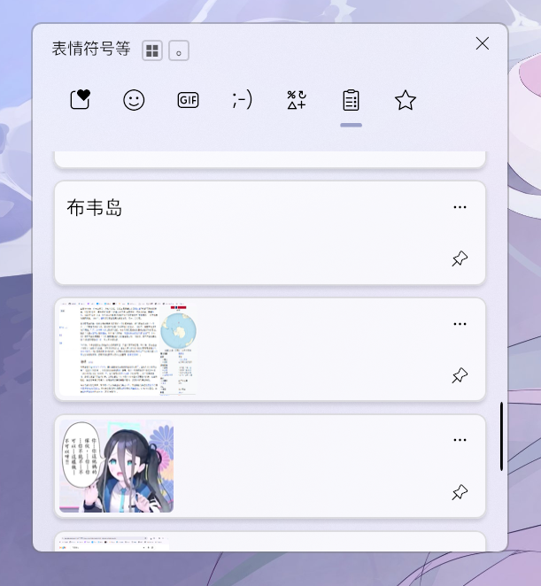

# WinVPlus

对WIN原生的剪切板的改进 并且尽量保持了一致的设计语言 历史上限从 25 条改成 300 条且新增了常用语功能

<p align="center">
  
  &nbsp;&nbsp;
  
</p>

- 历史上限从 25 条改成 300 条。
- 顶部剪贴板右边多一个星标，用来放常用语。
- 右键文字或图片记录，在原生操作区点星标。也可以点记录原来的三个点。
- 在常用语里点内容就粘贴，点右侧的垃圾桶就移出。

**目前是实验版。** 针对 Windows 11 x64 开发。确认过的开发环境是 25H2 / 26200.6725；不一定是所有 Windows 版本通用的补丁（

### 0.2.0 修了什么

- 加了可选的登录自启。便携版以前只复制 mod，Windhawk 没运行就不会有星标和扩容。现在可以注册当前用户的计划任务，登录 15 秒后在托盘启动；不会保存密码。
- 收藏索引按文件时间和大小缓存。文件没变就复用，打开同一页只核对版本，不反复传整份文字和缩略图。文件被外部修改时会重新读取；损坏文件会报错并保留。
- 收藏先显示最近 24 条，继续往下滚或点「继续显示」再加载。重新打开保留已有卡片和图片。
- 原生历史新增卡片时只处理变化的节点，不再因为操作按钮变化就重扫整页。
- 更新安装时备份旧配置和源码，并保留用户自己调的容量、启用状态和收藏。

这些改动减少的是本扩展增加的读取和渲染成本。Windows 原生历史仍由系统读取，未替换成自制历史数据库，也没有自动备份普通历史。重启后普通历史的清理规则不变。

当前开发机上已确认原生标签、文字添加和保存、图片收藏和粘贴、移出时的原生过渡，以及关闭重开面板。系统接口已实际返回 34 条历史记录，超过原有的 25 条。模拟交互测试与 Windows 自带的 PNG 编解码验证通过。300 条历史的完整容量测试、跨重启及其它系统版本仍待验证；目前先公开源码，不发布稳定版安装包。

## 怎么用

需要 [Windhawk](https://windhawk.net/)。目前开发时使用 1.7.3。

如果你已经装了 Windhawk，可以把生成的 `dist/history-limit.wh.cpp` 和 `dist/phrases.wh.cpp` 分别作为本地 mod 编译加载。

源码构建：

```powershell
.\scripts\build.ps1 -Windhawk 'C:\Tools\Windhawk'
```

其中的路径换成你自己的 Windhawk 目录。需要它自带的 Compiler 组件。

便携版 Windhawk 还可以使用安装脚本：

```powershell
.\scripts\install.ps1 -Windhawk 'C:\Tools\Windhawk'
```

需要重启后自动恢复功能的话，用**管理员 PowerShell**执行一次：

```powershell
.\scripts\install.ps1 -Windhawk 'C:\Tools\Windhawk' -EnableStartup -StartNow
```

自启任务名为 `WinVPlus-Windhawk`，只在当前用户登录时运行。选择最高权限是因为扩容 mod 要进入剪贴板服务；普通用户的启动文件夹快捷方式不够。任务不会自动重启系统或清空剪贴板。已经运行的 Windhawk 需要先退出再重新启动，才能加载更新的 DLL。

单独启用或取消自启也可以用（同样需要管理员 PowerShell）：

```powershell
.\scripts\enable-startup.ps1 -Windhawk 'C:\Tools\Windhawk' -StartNow
.\scripts\enable-startup.ps1 -Windhawk 'C:\Tools\Windhawk' -Remove
```

备份在 Windhawk 的 `AppData\WinVPlusBackups\时间戳`。回退时先退出 Windhawk，再把其中的两个 `.ini` 放回 `AppData\Engine\Mods`，两份 `.wh.cpp` 放回 `AppData\ModsSource`。旧 DLL 会保留。`%LOCALAPPDATA%\WinVPlus` 内的收藏文件不由安装脚本修改。

这个脚本只支持默认 AppData 布局的便携版，不给标准安装版写注册表。首次加载时启动 Windhawk。扩容涉及系统剪贴板服务，需要以管理员身份运行 Windhawk；新增标签在下次打开 Win+V 时出现。

## 目录

```text
WinVPlus/
├─ mods/
│  ├─ history-limit.wh.cpp  # 三个历史容量 getter
│  └─ phrases.wh.cpp       # 接入原生面板、读取记录、文字和图片的保存与粘贴
├─ ui/
│  └─ phrases.js           # 星标标签、常用语列表及原生操作列表扩展
├─ scripts/
│  ├─ build.ps1            # 把 JS 嵌入 C++，生成两份独立 mod 和 DLL
│  └─ install.ps1          # 把编译结果放进便携版 Windhawk
└─ tests/
   └─ phrases.test.cjs     # 导航、右键、长文本、粘贴及卸载的模拟测试
```

运行时就是两份 mod，不需要 Node.js，也不开本地网页服务。Node.js 和 jsdom 只用来测试。

不在 Windows 系统目录里添加或替换文件。收藏存在当前用户的 `%LOCALAPPDATA%\WinVPlus\`：

```text
WinVPlus/
├─ phrases.json           # 文字、图片索引及小预览，普通 UTF-8 JSON
└─ images/
   └─ {id}.png            # 收藏的原图；移出收藏时一并删除
```

## 实现

扩容 mod 在 `cbdhsvc.dll` 上调整三项内部设置：300 条、单条 32 MiB、总缓冲区 1024 MiB。它们分别可调。300 是条数上限；达到总量上限时也会淘汰旧记录。

Windhawk 按 `svchost.exe` 匹配扩容 mod。mod 初始化时会先检查服务组，不属于剪贴板相关服务组就退出，不给其它服务挂容量钩子。

常用语 mod 接入 `TextInputHost.exe` 中原有的 WebView。标签切换直接使用页面现有的自定义导航回调，不在导航容器上捕获全部点击。页面把操作放进一个小队列；原生侧在面板打开时每 100 ms 检查一次，收起约一秒后停止。它不使用页面导航来传消息。

添加常用语时，通过公开 Clipboard History API 按记录 ID 读取完整文字或位图。ID 比较忽略大小写，兼容页面与公开接口返回的不同写法。不会拿面板里的 200 字预览当正文。图片用 Windows 自带的编解码器保存为 PNG，列表用最长边 256 像素的小预览，粘贴用原图。保存后，收藏独立于普通历史，清空历史不会清掉它。

历史记录直接在现有的 observable action 列表里追加收藏星标，渲染、点击和操作区的展开都交给 Windows。星标没有额外文字或悬停提示。常用语列表复用当前系统页面的卡片、字体和间距样式类；右侧垃圾桶直接移出收藏。没有另建浮动菜单，也不计算菜单的屏幕位置。

常用语页在面板收起时交还原生列表，避免隐藏样式干扰系统的关闭动画。显示收藏时倒序遍历已有索引，不用迁移文件。

列表按记录 ID 保留卡片节点，刷新数据不会清空再重建整页。移出收藏复用系统页面现有的缩小、淡出和后续卡片上移动画；动画与保存完成后才移除目标节点。其余图片节点继续保留，避免重新加载时闪白。关闭系统动画时直接完成，不增加动画依赖。

普通历史的重启清理规则仍由 Windows 决定。此版本不添加普通历史的跨重启备份。常用语会保留。

## 体积与兼容性

两个编译后的 mod 合计约 0.6 MiB。这个数字不包含 Windhawk、符号缓存和剪贴板内容。

Windhawk 的完整离线开发环境明显更大。开发机上的 Compiler 约 543 MiB，管理界面约 236 MiB；仓库不携带这些工具，也不把完整工具环境算进“补丁体积”。

容量 getter、`InputApp.dll` 符号及页面内部模型都不是微软保证稳定的扩展接口。Windows 更新可能让其中一处失效。目前没有 Win10、ARM64 或跨所有 servicing build 的兼容保证。

关闭两个 mod 即可停用。整个收藏文件夹独立保存，便于自己迁移。

## 开发测试

```powershell
npm ci
npm test
```

存储缓存另有一个隔离测试，使用真实 Windows JSON 接口和临时数据目录，不读取用户收藏：

```powershell
.\tests\storage.test.ps1 -Windhawk 'C:\Tools\Windhawk'
```

模拟测试不代替真实 Win+V 验收。发布前还需要实际测试：打开面板、右键添加、长文字保存、点击粘贴、关闭重开、清空普通历史后常用语仍在。

代码使用 MIT 许可。接入方式参考的项目见 [THIRD_PARTY_NOTICES.md](THIRD_PARTY_NOTICES.md)。
